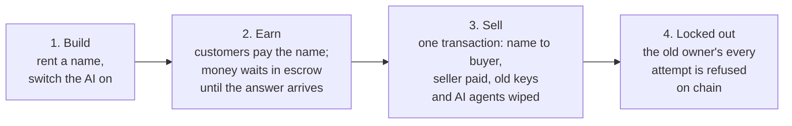

# Holdfast

[](https://github.com/codemagician1949/Holdfast/actions/workflows/ci.yml)

**Holdfast turns a NEAR name into a small business you can sell.** An AI service lives inside the name and earns from paid jobs. Sell the name, and the buyer gets the business, its future earnings and its public record, while every key and AI agent the seller left behind stops working. The chain enforces that, not a promise from the seller.

**In 30 seconds**
- **What:** a name on NEAR (like `preflight.bot`) that is at once an NFT you own, a wallet that collects payments, and a paid AI service with a public track record.
- **For whom:** anyone who builds an AI service or agent and may want to sell it one day, and anyone who wants to buy one without trusting the seller.
- **Why only on NEAR:** on NEAR the NFT *is* the account, so the account's own code can take the seller's access away at the moment of sale. On other chains an NFT only points at a wallet somewhere else.



- **Live app:** https://holdfast-near.vercel.app · **Network:** NEAR **testnet** only · **License:** MIT
- **Video + post on X:** https://x.com/CMagician1604/status/2121220366974464018
- **Tracks:** `nfts` (lead) · `security` · `agents` ([how each track's prompt is answered](docs/DETAILS.md#track-fit))
- **Formerly named Deed**, renamed on 12 Nov 2026 because a different team's project has the same name; the two share no code ([details](#name-and-history)).

## The problem, in plain words

Selling an online business or an AI agent today means handing over logins, API keys and wallet access, and trusting the seller not to keep a copy. Holdfast puts the business inside a NEAR name instead, so selling the name sells the business, and nothing the seller kept still works.

The service in the demo is **Preflight**: before you or your AI agent sign a NEAR transaction, it explains it in plain words and flags anything risky. Each answer costs 0.05 test NEAR and is written and signed inside a secure enclave on NEAR AI.

## What Holdfast built, and what it builds on

**Builds on (not ours):** House of Stake's **Top Level Accounts** make a rented name both an NEP-171 NFT and a keyless account, and wipe every agent permission when the name changes owner ([source](https://github.com/houseofstake/tla-contracts); audited by Valhalla Security according to [their README](https://github.com/houseofstake/tla-contracts#status); live on mainnet as [`registry.hos`](https://nearblocks.io/address/registry.hos)). It isn't deployed on testnet, so we run the **byte-identical mainnet bytecode** under team accounts, and the checker compares the code hashes with mainnet live.

**Holdfast adds (ours, not audited):**
- **Activation registry:** the owner switches the service on under the name, and only the current owner can.
- **Sale escrow with royalties:** the buyer pays the exact price; the name moves and the seller is paid in the same transaction, minus a 2.5% royalty; if anything fails, the buyer gets everything back.
- **Job escrow:** a customer's payment is held by the contract until the answer is delivered, and refunded if it isn't.
- **The Preflight runtime on NEAR AI's TEE:** it re-checks the owner on every job, and its answers carry an enclave signature anyone can verify.
- **Counterparty checks for agents that pay:** a free allow / warn / block check, a shared blocklist contract, and an agent vault that refuses reported receivers on chain ([details](docs/DETAILS.md#for-agents-that-pay-track-security)).
- **The web app**, and a **verifier** that attacks every sale from the seller's side and checks each claim on chain.

**What Holdfast's own contracts enforce that House of Stake's don't** (sandbox tests in [contract/deed/tests/](contract/deed/tests/)):
- **A sale in the middle of a paid job can't pay the new owner's name:** the customer is refunded. Test: `sale_in_the_middle_of_a_paid_job_refunds_the_payer`.
- **The sale is all or nothing:** if the payout switch or the name transfer fails, the buyer gets the whole price back. Tests: `forced_transfer_failure_refunds_buyer`, `failed_payout_repoint_stops_the_sale_and_refunds_the_buyer`, and `failed_transfer_refunds_buyer_on_real_bytecode` on House of Stake's mainnet bytecode.
- **An old activation can't be replayed:** only the current owner can switch the service on, and each activation needs a higher version than the last. Test: `activation_requires_current_owner`.
- **Refunds never depend on the operator:** anyone can refund a job left unanswered for 15 minutes. Test: `job_refunds_never_depend_on_the_operator`.

## See it in 2 minutes (browser, no wallet)

1. **https://holdfast-near.vercel.app/deed/preflight.deedbot.deedhq.testnet**: every line under **History** is a testnet transaction: six sales, the wallet wiping the seller's permissions, earnings paid out, and each refused attempt by the old owner with the chain's own error. **Jobs answered** lists paid answers with their enclave-signature checks.
2. **https://holdfast-near.vercel.app/proof**: the live sale's attack run, one row per attempt, each linked to its transaction.
3. **https://holdfast-near.vercel.app/try**: click an example transaction and watch the free risk flags and the check of who it pays.

## Try it yourself (5 minutes, free test coins)

1. Install a NEAR wallet such as Meteor or MyNearWallet, switch it to **testnet**, and get free test NEAR from [near-faucet.io](https://near-faucet.io).
2. On [Try Preflight](https://holdfast-near.vercel.app/try), click **Approve unlimited token spending**. You see a high-risk flag before paying anything.
3. Connect your wallet, pick a Holdfast, click **Pay 0.05 NEAR and explain**, and approve in your wallet.
4. **You see** the card go from *Answering…* to *Answered*, with a verdict (here *DO NOT SIGN*) and two ticks under the enclave signature. On that Holdfast's page, your payment appears under **Jobs answered** and its earnings go up by 0.05. If anything fails, the contract refunds you, and after 15 minutes anyone can trigger the refund.

## How it works

1. **Rent a name.** The name comes from House of Stake's registry. It is an account no person holds a key to; only its listed permissions can act for it.
2. **Switch the service on.** The owner records on chain which server answers for the name, its config and its price. Only the current owner can do this, and each new record needs a higher version, so an old one can't be replayed. (`activate`)
3. **Earn.** A customer pays for one answer. The Holdfast contract holds the money until the server answers, then pays it into the name's own wallet, but only if the same owner still owns the name; otherwise the customer gets it back. If nobody answers within 15 minutes, anyone can trigger the refund. (`pay_job`, `settle_job`, `refund_job`)
4. **List it for sale.** The name moves into the Holdfast escrow. At that moment the name's wallet wipes every permission the seller and their AI agents had, and pays the seller what the name earned. (`nft_transfer_call`)
5. **Buy.** The buyer pays the exact price. In one transaction the name moves to the buyer and the seller is paid, minus a 2.5% royalty. If any step fails, the buyer gets the whole price back. (`buy`)
6. **Switch it back on.** The buyer records their own activation, and the next paid answer lands in the same name, now for them.

Call-by-call sequence, contract API, runtime API and web routes: [docs/REFERENCE.md](docs/REFERENCE.md).

## What a sale guarantees

After a sale, enforced on chain: the seller's agent permissions and extensions are gone (G1); the seller can't sign in or act as the name (G2); what the name earned under the seller went to the seller, once (G3); the seller's activation and jobs paid before the sale can't pay the sold name (G4); the buyer paid exactly the price and the seller got it in the same transaction, or the buyer was refunded (G5). Each is attacked by the verifier: [the claim, who enforces it and where it's proven](docs/DETAILS.md#the-exact-security-claim) · [threat model, 43 rows](THREAT_MODEL.md) · [every guarantee by whose code](docs/INVARIANTS.md).

**Not claimed:** that the seller forgets what they knew, that an old operator's server can't answer (it just can't be paid), or that an answer is correct (the enclave signature proves it is authentic).

## Verify it from a clean clone

```bash
git clone https://github.com/codemagician1949/Holdfast && cd Holdfast
pip install dcap-qvl==0.7.1               # optional: verifies the Intel TDX quote locally (without it the checker asks Phala's hosted verifier)
python3 verify/check-testnet.py --runtime https://preflight-production-8802.up.railway.app   # ~1-3 min, no wallet, no NEAR
contract/test.sh                          # ~2-5 min (fetches the NEAR sandbox itself): 36 tests (`cargo test` prints 3+17+4 for deed, 5 reports, 6+1 agent-vault): deed 24 (21 in a local NEAR sandbox, 4 of those on House of Stake mainnet bytecode), reports 5, agent-vault 7 (1 in the sandbox with a real function-call key)
python3 verify/recompute-title.py --compare  # ~1 min: recomputes the title page's numbers from chain data (jobs and sales cross-checked against contract state) and compares with the page's own code
verify/rebuild-deed.sh                    # ~5 min, needs Docker: rebuilds the deployed Holdfast contract from the commit in its NEP-330 metadata and compares the hash
cd runtime && bun install && bun test     # seconds: 51 tests, prints `51 pass` (escrowed job rules, settle/refund on chain, sale mid-job, crash recovery, TEE signature, risk flags, counterparty check)
```

**You will see** `ALL CHECKS PASS`: mainnet and testnet code hashes match, every transaction in the published sale report exists with the outcome it claims, the hosted runtime is the one the chain names, and NEAR AI's enclave attestation verifies independently. [What each check proves, and the reconciled numbers](docs/DETAILS.md#what-the-checker-verifies-and-the-numbers).

## What is real today

Live on testnet: the contracts, two AI runtimes, the web app, and a real sale where every attack by the old owner was refused on chain ([evidence](docs/EVIDENCE.md)). All activity so far is between the team's own testnet accounts, so it shows the mechanism works, not that anyone else wants it. Not yet done: a buyer from outside the team running their own runtime ([runbook](docs/BUYER-RUNBOOK.md)), and a risk-flag accuracy test labelled by an outsider. Full table: [what is real and what isn't](docs/DETAILS.md#what-is-real-today-and-what-isnt).

## Glossary

| Word | Meaning |
|---|---|
| **TLA** (Top Level Account) | A name rented from House of Stake's registry, e.g. `preflight.deedbot.deedhq.testnet`. It is an NFT and a NEAR account at once. |
| **Keyless account** | An account no person holds a key for; only its code and its listed extensions can act for it. |
| **Extension** | A permission on the name's wallet: the owner, the lease authority, or an AI agent with a spending allowance. |
| **Rotation** | The wallet's change of owner when the name is sold or transferred. It removes every extension and spending allowance and pays the balance out to the previous owner. |
| **Activation** | The owner's on-chain record that switches the service on: which runtime, which config, which price. |
| **Runtime** | The server that answers paid jobs for a name. It can only be paid if the current owner's activation names it. |
| **Escrow** | The Holdfast contract holding money (a job payment or a sale price) until its conditions are met. |
| **TEE / enclave** | Hardware that runs the AI model and signs its answers, so anyone can check an answer wasn't changed. |
| **NEP-641, NEP-413** | NEAR standards for signing in as a name and for signed messages; the owners-only console uses them. |

## Prior art

ERC-6551 gives each NFT a separate account whose control follows the token; on NEAR the token and the account are the same name, and a sale also wipes delegated agent permissions and settles the balance to the seller. ERC-7857/0G iNFTs re-encrypt agent secrets on transfer through a TEE or oracle; Holdfast keeps nothing secret, and control passes because the wallet wipes extensions on rotation. Virtuals tokenises speculation on an agent; Holdfast sells the operating business (name, earnings, record). Flippa-style marketplaces rely on a trusted handover; here it is enforced on chain and attacked by a verifier.

## Built with

- **Libraries:** Rust `near-sdk` 5.30, `near-workspaces` 0.24; Bun with `@noble/curves` and `@noble/hashes`; React 19, Vite, Tailwind 4, shadcn/ui (Base UI), motion, react-router, `@hot-labs/near-connect`. Services: NEAR RPC, FastNEAR APIs, NEAR AI Cloud. NEAR features used, with file paths: [docs/DETAILS.md](docs/DETAILS.md#near-features-used).
- **Third-party code deployed unmodified:** House of Stake [`tla-contracts`](https://github.com/houseofstake/tla-contracts) mainnet bytecode, vendored with its hashes in [deploy/mainnet-wasm](deploy/mainnet-wasm/).
- **AI-assisted development (Q-005):** the code, tests, scripts and docs were written with an AI coding assistant (Claude Code), directed and reviewed by codemagician. Design critiques we asked AI models for are in [docs/process/](docs/process/): working notes, not external validation.
- **Baseline (Q-003):** everything here was built during the hackathon, from 2026-11-02. The tag `pre-hackathon` marks the first commit ([9aab65e](https://github.com/codemagician1949/Holdfast/commit/9aab65e)) and `hackathon-submission` the final one: [everything built during the hackathon](https://github.com/codemagician1949/Holdfast/compare/pre-hackathon...hackathon-submission).

## Name and history

Holdfast was called **Deed** until 12 Nov 2026. It was renamed because another NEAR Hackathon project, by a different team, is also called Deed (an NFT-owned keyless account with drain protection); the two were built independently and share no code. On-chain account names still say `deed` (`deed.deedhq.testnet`, `*.deedbot.deedhq.testnet`), because renaming them would mean redeploying every contract and losing the recorded evidence. The repo moved from github.com/codemagician1949/Deed (old links redirect), and deed-near.vercel.app still works.

## Team and other submissions

- **Team:** codemagician ([codemagician1949](https://github.com/codemagician1949) on GitHub), a team of one.
- **Other projects in this hackathon (Q-015):** none; Holdfast is codemagician's only submission. It shares no code, accounts or servers with any other project.

## Documents

[docs/DETAILS.md](docs/DETAILS.md) (full claim, track fit, agents, numbers) · [THREAT_MODEL.md](THREAT_MODEL.md) · [docs/INVARIANTS.md](docs/INVARIANTS.md) · [docs/EVIDENCE.md](docs/EVIDENCE.md) (live sale, live jobs, bugs found) · [docs/REFERENCE.md](docs/REFERENCE.md) (run it, call-by-call, APIs) · [docs/CLIENTS.md](docs/CLIENTS.md) · [docs/BUYER-RUNBOOK.md](docs/BUYER-RUNBOOK.md) · [docs/SPIKE.md](docs/SPIKE.md) · [docs/RESEARCH.md](docs/RESEARCH.md)
